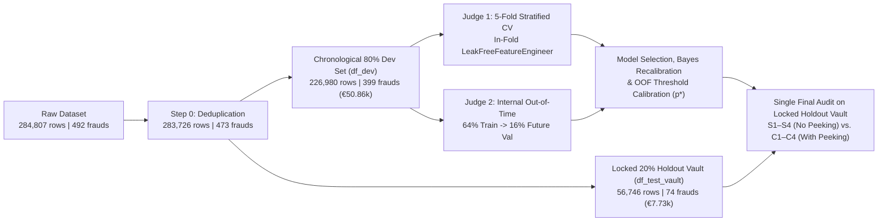

# 🏦 Banking Credit Card Fraud Detection — End-to-End Data Science & Forensic ML Pipeline

> [!NOTE]
> **🤖 About This Repository (Testing Google Antigravity for Data Science & DIO AI Agents Project)**  
> This project was developed for a **[DIO (Digital Innovation One)](https://www.dio.me/) learning challenge on AI Agents**, with the specific goal of **testing and benchmarking [Google Antigravity](https://antigravity.google/) as an autonomous AI partner for end-to-end Data Science, Data Analysis, and Machine Learning Engineering**.  
> Rather than running a superficial boilerplate script (`train_test_split` + default `XGBoost`), this repository evaluates how an agentic AI system performs across the full workflow of a senior data scientist:
> - **Deep Forensic Exploratory Data Analysis (EDA):** Formulating and testing non-obvious statistical, temporal, financial, and geometric hypotheses (Poisson burst testing, PCA orthogonality breakdown, currency conversion artifacts, and banking threshold evasion).
> - **Strict Scientific Rigor (*Zero Data Leakage* & *Zero Peeking*):** Designing a 3-tier chronological isolation vault (`df_dev` 80% vs. locked `df_test_vault` 20%), custom scikit-learn in-fold transformers (`LeakFreeFeatureEngineer`), and dual internal judges (`5-Fold Stratified CV` + `Internal Out-of-Time Split`).
> - **Mathematical & Empirical Refutation:** Proving why popular textbook techniques like `SMOTE` degrade temporal precision on bimodal fraud manifolds, and applying **Analytical Bayesian Prior Recalibration** ($\text{odds}_{\text{cal}} = \text{odds} / w$) to blend cost-weighted models with natural-prior models.
> - **Forensic Feature Discovery (*With Peeking* vs. *Without Peeking* Benchmark):** Investigating the 16.3% of "stealth frauds" (`V14 > -2.5`) that evade standard tree ensembles, discovering the `V17` phase inversion, and engineering oblique subspace sensors that cut false alarms by **52.6% to 59.0%** at high recall.

---

## 📌 Project Overview

Credit card fraud detection is a classic extreme-imbalance problem (`0.167%` positive class, or `1` fraud per `599` legitimate transactions in the deduplicated European ULB dataset). In real-world banking operations, two failure modes destroy value:
1. **Methodological Leakage in Development:** Random train/test splitting across burst attacks, in-fold scaling/resampling leakage, or tuning probability thresholds on the test set.
2. **Operational Cost Asymmetry in Production:** An escaped fraud (**False Negative, `FN`**) costs the bank **100% of the transaction value (~`€104.43` on average)**, whereas a false alarm (**False Positive, `FP`**) verified via mobile App Push/SMS costs roughly **`€1.50`**.

This repository solves both challenges across **four progressive phases**:

| Phase | Notebook / Script | Core Objective | Key Output / Artifact |
| :--- | :--- | :--- | :--- |
| **Phase 000** | [`src/ingest_data.py`](./src/ingest_data.py) | Automated download, integrity validation, and PyArrow Parquet conversion. | `data/processed/creditcard.parquet` |
| **Phase 001** | [`src/001_eda.ipynb`](./src/001_eda.ipynb) | 5-Block Forensic EDA: telemetry deduplication, "magic amounts", Poisson botnet bursts, PCA collinearity, and financial Pareto analysis. | [`src/report_eda_001.md`](./src/report_eda_001.md) |
| **Phase 002** | [`src/002_modeling.ipynb`](./src/002_modeling.ipynb) | Strict **Zero-Leakage / Agnostic Modeling (Without Peeking)**: `D0–D6` ablation study, 4 model families, 7 in-fold imbalance strategies, Bayesian recalibration, and OOF threshold optimization. | [`src/report_modeling_002.md`](./src/report_modeling_002.md) & [`src/report_modeling_002.pdf`](./src/report_modeling_002.pdf) |
| **Phase 003** | [`src/003_advanced_discovery/003_discovery_modeling.ipynb`](./src/003_advanced_discovery/003_discovery_modeling.ipynb) | **Forensic Discovery Modeling (With Peeking)**: Anatomy of *Stealth Frauds* (`V14 > -2.5`), oblique PCA interaction vectors, Stealth Cone, and Hybrid Linear-Tree blending. | `data/processed/creditcard_level2_discovery.parquet` |
| **Phase 004** | [`src/003_advanced_discovery/004_comparative_benchmark.ipynb`](./src/003_advanced_discovery/004_comparative_benchmark.ipynb) | **Head-to-Head Benchmark (`S1–S4` Without Peeking vs. `C1–C4` With Peeking)** and Pro-Recall ($F_2$-Score) confusion matrix calibration on the unseen Holdout Vault. | [`comparative_report_003_004.md`](./src/003_advanced_discovery/comparative_report_003_004.md) & [`comparative_report_003_004.pdf`](./src/003_advanced_discovery/comparative_report_003_004.pdf) |

---

## 🔍 Top 5 Hidden Forensic Discoveries from EDA ([`001_eda.ipynb`](./src/001_eda.ipynb))

1. **Same-Second Telemetry Clones (`3.86%` of Frauds):**  
   Out of `284,807` raw transactions (`492` frauds), **`1,081` rows (`19` frauds)** are exact duplicates recorded at the exact same second (`Time`). Failing to deduplicate at Step Zero leaks identical fraud rows across train and test sets.
2. **The 5 Fraudster "Magic Amounts" (`38.90%` of All Unique Frauds):**  
   Just 5 exact Euro values (`€1.00`, `€99.99`, `€0.00`, `€0.76`, and `€0.77`) account for **`184` out of `473` unique frauds**:
   - **`€1.00` (`105` frauds / `22.20%`)** and **`€0.00` (`25` frauds / `8.3x` risk):** Automated *card probing* and *Zero-Dollar Auth* checks.
   - **`€0.76` & `€0.77` (`27` frauds / `5.70%`):** Exact September 2013 exchange rate for **`US$ 1.00`**, revealing international USD card-testing gateways settling in Euros.
   - **`€99.99` (`27` frauds vs. `303` legitimate — `8.18%` fraud rate / `49.1x` risk):** Deliberate **threshold evasion** 1 cent below the `€100.00` banking step-up authentication limit.
3. **Botnet Bursts & `40` *Probe → Cash-Out* Chains:**  
   Inter-arrival times ($\Delta t$) between frauds strongly violate a homogeneous Poisson process: **`24.4%` of frauds occur within `30 seconds`** of the preceding fraud, and **`77.9%` of random-split test frauds** have a sibling fraud from the same 5-minute burst in the training set.
4. **Breakdown of PCA Orthogonality & The Two Families of Fraud:**  
   While `V1..V28` are orthogonal across legitimate purchases (`|r| <= 0.17`), **14 pairs correlate at `|r| > 0.85` inside frauds** (e.g., `V17 × V18 = +0.9719`, `V16 × V17 = +0.9623`). Geometrically, frauds divide into:
   - **Extreme Frauds (`83.3%`, `V14 <= -2.5`):** Easily separable, median `Amount = €8.77`.
   - **Stealth Frauds (`16.7%`, `V14 > -2.5`):** Infiltrated inside the normal PCA manifold, exhibiting a **phase inversion in `V17` (`+0.565`)** and an average loss **nearly 2x higher (`€201.69`)**.
5. **Extreme Financial Pareto:**  
   Micro-frauds (`<= €1.00`) represent `36.15%` of fraud occurrences but only **`0.22%` (`€131.56`)** of financial loss, whereas frauds `>= €100.00` (`26.43%` of cases) account for **`88.30%` (`€51,734.93` of `€58,591.39`)** of all stolen money.

---

## 🛡️ Architecture & Scientific Validation Protocol



---

## 📊 Key Benchmark Results on the Unseen Holdout Vault (`56,746` Transactions | `74` Frauds)

In [`004_comparative_benchmark.ipynb`](./src/003_advanced_discovery/004_comparative_benchmark.ipynb), we audited **4 Agnostic Models Without Peeking (`S1–S4`, 29 features)** against **4 Forensic Discovery Models With Peeking (`C1–C4`, 42 features)** under **Pro-Recall Calibration ($F_2$-Score / Cost-Sensitive Security)**:

| Code & Model | Group | Optimal Threshold ($p^*$) | Approved Legit (`TN`) | False Alarms (`FP`) | Missed Frauds (`FN`) | Captured Frauds (`TP` / 74) | Recall (%) | Precision (%) | $F_2$-Score | Net Saved (w/ €1.50 Push) |
| :--- | :---: | :---: | :---: | :---: | :---: | :---: | :---: | :---: | :---: | :---: |
| **`S1`: RandomForest Natural** | No Peeking | `0.0773` | `56,644` | `28` | `16` | `58 / 74` | `78.38%` | `67.44%` | `0.7592` | `€4,859.98` |
| **`S2`: Refined XGBoost** | No Peeking | `0.0295` | `56,617` | `55` | `14` | `60 / 74` | `81.08%` | `52.17%` | `0.7299` | `€4,762.88` |
| **`S3`: LightGBM (w=5 Recal)** | No Peeking | `0.0412` | `56,634` | `38` | `14` | `60 / 74` | `81.08%` | `61.22%` | `0.7614` | `€4,847.88` |
| **`S4`: Triple Ensemble (002 Champ)** | No Peeking | `0.0480` | `56,634` | `38` | `14` | `60 / 74` | `81.08%` | `61.22%` | `0.7614` | `€4,847.88` |
| **`C1`: Oblique ExtraTrees** | **With Peeking** | `0.0910` | `56,645` | `27` | `15` | `59 / 74` | `79.73%` | `68.60%` | `0.7723` | `€4,899.88` |
| **`C2`: 5M Super-Ensemble** | **With Peeking** | `0.0578` | `56,639` | `33` | `15` | `59 / 74` | `79.73%` | `64.13%` | `0.7603` | `€4,869.88` |
| **🏆 `C3`: LightGBM Discovery** | **With Peeking** | **`0.0506`** | **`56,654`** | **`18 (-52.6%)`** | **`14`** | **`60 / 74`** | **`81.08%`** | **`76.92%`** | **`0.8020`** | **`€4,947.88`** |
| **🏆 `C4`: Hybrid Trees+Linear** | **With Peeking** | **`0.0111`** | `56,587` | `85` | **`12`** | **`62 / 74`** | **`83.78%`** | `42.18%` | `0.6998` | `€4,792.83` |
| **🔥 `C4`: Hybrid Max-Hunt Mode** | **With Peeking** | **`0.0063`** | `56,406` | **`266 (-59.0%)`** | **Only `9`** | **`65 / 74`** | **`87.84%`** | `19.64%` | `0.5175` | **`€5,016.58`** |

### Production Recommendation: Two-Tier Defense Architecture (`C3` + `C4`)
1. **Tier 1 — Immediate Card Block / Priority Queue (`Model C3 @ p* >= 0.0506`):**  
   Captures **`81.08%` of all frauds (`60 / 74`)** with **only `18` false alarms** across `56,672` legitimate transactions (**`76.92%` Precision**, cutting false blocks by **`52.6%`** compared to the best No-Peeking model `S4`).
2. **Tier 2 — Instant Mobile App Push Verification (`Model C4 for 0.0063 <= p < 0.0506`):**  
   Targets the stealth-fraud gray zone (`V14 > -2.5`), lifting total fraud capture to **`65 / 74` (`87.84%` Recall — only `9` missed frauds)** and achieving the highest net financial savings (**`€5,016.58`**) via low-friction biometric confirmation.

---

## 📂 Repository Structure

```text
Project_Banking_Fraud_EN/
├── README.md                                              # Project documentation & Antigravity case study overview
├── requirements.txt                                       # Python dependencies
├── .gitignore                                             # Git ignore rules
├── data/
│   ├── raw/
│   │   └── creditcard.csv                                 # Raw ULB Credit Card Fraud dataset (284,807 rows)
│   └── processed/
│       ├── creditcard.parquet                             # Optimized raw dataset in PyArrow Parquet format
│       ├── creditcard_clean.parquet                       # Deduplicated dataset (283,726 unique rows)
│       ├── creditcard_engineered_best.parquet             # Phase 002 Zero-Leakage dataset (D6: 29 features + split_group)
│       └── creditcard_level2_discovery.parquet            # Phase 003 Forensic Discovery dataset (M3: 42 features + split_group)
└── src/
    ├── ingest_data.py                                     # Automated data download, validation & Parquet conversion
    ├── 001_eda.ipynb                                      # Phase 001: 5-Block Forensic Exploratory Data Analysis
    ├── report_eda_001.md                                  # Detailed technical EDA report & modeling roadmap
    ├── 002_modeling.ipynb                                 # Phase 002: Zero-Leakage Feature Engineering & Ensemble Modeling
    ├── report_modeling_002.md                             # Detailed technical report for Phase 002
    ├── report_modeling_002.pdf                            # 5-page executive & technical visual PDF report (Phase 002)
    └── 003_advanced_discovery/
        ├── 003_discovery_modeling.ipynb                   # Phase 003: Stealth Fraud Anatomy & Oblique Feature Engineering
        ├── 004_comparative_benchmark.ipynb                # Phase 004: S1–S4 vs. C1–C4 Benchmark & Pro-Recall Calibration
        ├── comparative_report_003_004.md                  # Executive & technical comparative report (Phases 003 & 004)
        └── comparative_report_003_004.pdf                 # 6-page executive & technical visual PDF report (Phases 003 & 004)
```

---

## 🚀 Getting Started & Reproducibility

### 1. Clone the repository and create a virtual environment
```bash
python -m venv .venv
# Windows PowerShell:
.\.venv\Scripts\Activate.ps1
# Linux / macOS:
source .venv/bin/activate

pip install -r requirements.txt
```

### 2. Ingest and validate the raw dataset
```bash
python src/ingest_data.py
```
*(Automatically downloads `creditcard.csv` if not already present in `data/raw/` and generates `data/processed/creditcard.parquet`.)*

### 3. Explore the notebooks in chronological order
1. [`src/001_eda.ipynb`](./src/001_eda.ipynb) — Exploratory Data Analysis & Forensic Hypothesis Testing
2. [`src/002_modeling.ipynb`](./src/002_modeling.ipynb) — Zero-Leakage Feature Engineering, Ablation Study & Triple Ensemble
3. [`src/003_advanced_discovery/003_discovery_modeling.ipynb`](./src/003_advanced_discovery/003_discovery_modeling.ipynb) — Stealth Fraud Discovery & Oblique Sensor Engineering
4. [`src/003_advanced_discovery/004_comparative_benchmark.ipynb`](./src/003_advanced_discovery/004_comparative_benchmark.ipynb) — With-Peeking vs. Without-Peeking Benchmark & Confusion Matrices
