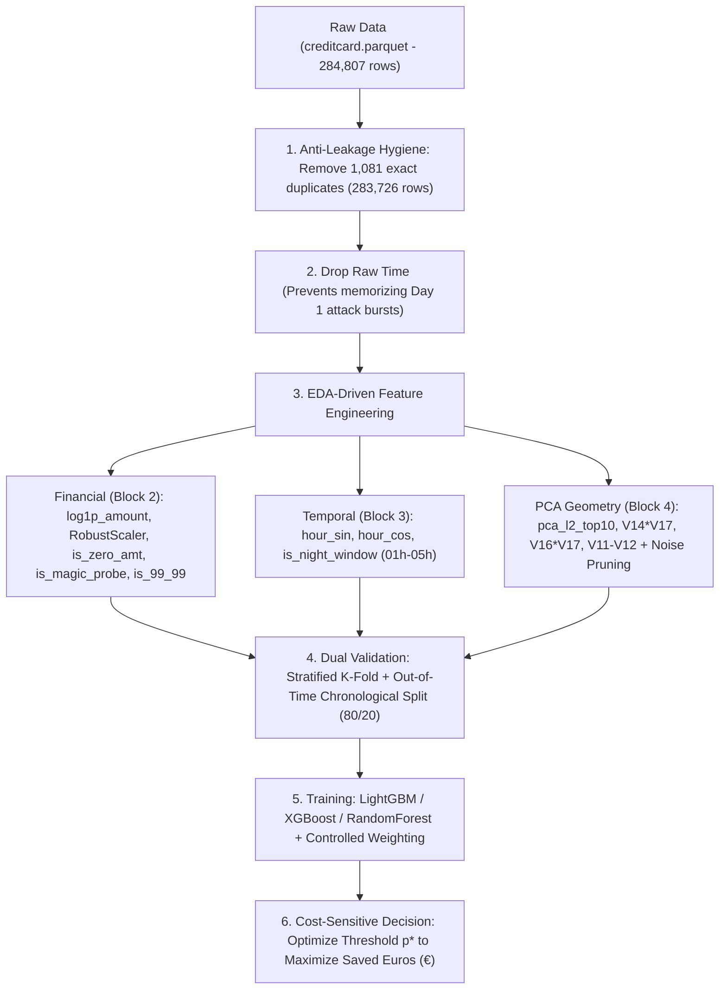

# Technical Report: Exploratory Data Analysis (EDA) and Hidden Forensic Discoveries
**Project:** Credit Card Fraud Detection (`Project_Banking_Fraud`)  
**Code References:** [`src/001_eda.ipynb`](./001_eda.ipynb) and [`src/ingest_data.py`](./ingest_data.py)  
**Dataset:** [`data/processed/creditcard.parquet`](../data/processed/creditcard.parquet) (Source: ULB / TensorFlow Official Datasets)

---

## 1. Executive Summary

This document consolidates the statistical, financial, temporal, and geometric investigation conducted in notebook [`001_eda.ipynb`](./001_eda.ipynb). The objective of our Exploratory Data Analysis (EDA) was not merely to describe the dataset, but to **uncover hidden behavioral patterns of real fraudsters** and turn them into competitive advantages for Feature Engineering, validation design, and model training (`LightGBM`, `XGBoost`, etc.).

> [!IMPORTANT]
> **Synthesis of the 5 Major Hidden EDA Discoveries:**
> 1. **Double-Logging Data Leakage:** `3.86%` of all frauds (`19` out of `492`) are exact duplicate records logged at the exact same second (`Time`). Failing to remove them prior to train/test splitting causes direct *data leakage*.
> 2. **The 5 "Magic Attack Amounts":** Just 5 exact Euro values (`€1.00`, `€99.99`, `€0.00`, `€0.76`, and `€0.77`) account for **`38.90%` (`184` of `473`) of all unique frauds in the bank**, revealing automated *card probing* and banking limit evasion (*threshold evasion* at `€99.99`, where fraud risk is **49.1x higher**).
> 3. **Botnet Bursts and *Probe → Cash-Out* Chains:** `24.4%` of all frauds occur within `30 seconds` of the previous fraud, and we identified **`40` chronological sequences** where a micro-probe fraud (`<= €1.00`) is followed within seconds by a high-value fraudulent cash-out (`>= €50.00`).
> 4. **PCA Orthogonality Breakdown and *Stealth* Frauds:** Although PCA features `V1..V28` have zero correlation across legitimate purchases, **14 feature pairs exhibit extreme correlation `|r| > 0.85` inside the fraud class** (reaching `+0.9719` for `V17 × V18`). Furthermore, `16.7%` of frauds (`V14 > -2.5`) are **camouflaged inside the legitimate cloud** and have an average transaction value nearly 2x higher (`€201.69`).
> 5. **Financial Pareto and Burst Leakage:** `36.15%` of frauds (`<= €1.00`) represent only **`0.22%` of total financial loss**, whereas `26.43%` of frauds (`>= €100.00`) concentrate **`88.30%` of all stolen Euros (`€51,734.93` out of `€58,591.39`)**. Moreover, under a standard random `train_test_split`, **`77.9%` of test-set frauds** have a "sibling" fraud from the exact same burst in the training set within 5 minutes.

---

## 2. Detailed Breakdown of the 5 Analysis Blocks ([`001_eda.ipynb`](./001_eda.ipynb))

### Block 1: Data Quality, Duplicates, and Structural Integrity
*(Ref.: Cells 1 to 5 of [`001_eda.ipynb`](./001_eda.ipynb))*

#### What Was Analyzed and Why
Before computing any statistics, we verified the physical integrity of the dataset (`284,807` rows × `31` columns, `0` missing values, `0` negative values in `Amount`, and `Time` 100% monotonically non-decreasing from `0.0s` to `172,792.0s`). Next, we separated two distinct phenomena that are frequently conflated:
1. **Exact Duplicates (all 31 columns identical, including timestamp `Time`):** Represent telemetry/logging glitches where the exact same transaction was recorded 2x to 18x within the same second.
2. **Temporal Near-Duplicates (`V1..V28` and `Amount` identical, but different `Time`):** Represent recurring transactions or repeated purchases from the same card/terminal at different times.

#### Numerical Results

| Class | Raw Total | Exact Duplicates (`keep='first'`) | Unique Rows (`df_clean`) | % Duplicated in Class | Near-Duplicates at Different Seconds |
| :--- | :---: | :---: | :---: | :---: | :---: |
| **0 — Legitimate** | `284,315` | `1,062` | `283,253` | `0.37%` | `8,063` |
| **1 — Fraud** | `492` | **`19`** | **`473`** | **`3.86%`** | **`0`** |
| **Grand Total** | **`284,807`** | **`1,081`** | **`283,726`** | **`0.38%`** | **`8,063`** |

- **Same-second multiplicity:** The `1,081` excess copies originate from `773` distinct transactions (`1,854` involved rows), with some transactions repeated up to **18 times in the same second**. Among frauds, `13` distinct transactions generate the `19` extra copies (`11` repeat 2x, `1` repeats 4x, and `1` repeats 6x).
- **Zero Label Noise:** There are **`0` cases** of transactions sharing identical `V1..V28` + `Amount` labeled simultaneously as `0` and `1`.
- **Discovery of *Zero-Dollar Auth* (`Amount == 0.00`):** There are `1,825` raw transactions (`1,808` unique) with value `€0.00`. Among them, the fraud rate jumps from `0.1643%` to **`1.4795%` (`1.3827%` in the deduplicated dataset — ~8.3x higher risk)**, as fraudsters use zero-amount authorization requests to verify whether a cloned card is active.

---

### Block 2: Deep Dive into the Financial Variable (`Amount`)
*(Ref.: Cells 6 to 9 of [`001_eda.ipynb`](./001_eda.ipynb))*

#### What Was Analyzed and Why
Unlike `V1..V28`, `Amount` is on its original Euro (`€`) scale and exhibits extreme skewness (`Skewness = 17.00`, `Kurtosis = 846.14`). We investigated why the mean and median tell opposite stories and inspected the exact cent values most frequently used by criminals.

#### Explanation of Hidden Findings
1. **The Mean vs. Median Paradox (Bimodality):**
   - The **mean** fraud amount (`€123.87`) is **40% higher** than that of legitimate purchases (`€88.41`), yet the **median (`P50`)** fraud amount (`€9.82`) is **55% lower** than legitimate purchases (`€22.00`), and the 1st quartile (`P25`) of frauds is exactly **`€1.00`** (vs. `€5.67` for legitimate transactions).
   - **Why does this happen?** Because criminal attacks are **bimodal**: first comes a massive wave of **micro-probes (`<= €1.00`)** to validate live cards (`36.15%` of all frauds), followed by a second wave of **high-value cash-out purchases (`P75 = €105.89`, `P95 = €655.82`)**.
2. **The 5 Fraudster "Magic Amounts" (`38.90%` of all frauds in the dataset!):**
   - **`€1.00`:** Alone accounts for **`105` frauds (`22.20%` of all unique frauds in the bank!)**.
   - **`€99.99`:** Accounts for **`27` frauds (`5.71%` of all frauds)** against only `303` legitimate transactions — an astonishing **fraud rate of `8.18%` (`49.1x` higher risk than baseline!)**. The operational explanation is clear: banking anti-fraud rules frequently trigger step-up authentication (3D-Secure / SMS) or manual review starting at **`€100.00`**; fraudsters hardcode charges at **`€99.99`** (1 cent below the threshold) to bypass friction!
   - **`€0.00`:** Accounts for **`25` unique frauds (`5.29%`)**, fraud rate of `1.38%` (`8.3x` risk).
   - **`€0.76` and `€0.77`:** Combine for **`27` frauds (`17` + `10` = `5.70%`)**. Because this European dataset was collected in **September 2013**, the exchange rate for **`US$ 1.00` (1 US Dollar)** at the time was exactly **`€0.76`–`€0.77`** — meaning these are $1.00 USD card-probing tests processed through international gateways and converted to Euros!
3. **The "U-Shaped" Risk Curve and the Hard Ceiling (`€2,125.87`):**
   - Fraud risk is extremely high up to `€1.00` (`1.38%` at `€0.00` and `0.51%` up to `€1.00`), drops to its minimum in the everyday spending band of `€5.00 to €25.00` (`0.0668%`), climbs back to **`0.40%`** between `€500.00 and €2,125.87`, and drops to **`0.0000%` above `€2,125.87`** (`0` frauds across `603` legitimate purchases reaching up to `€25,691.16`).

---

### Block 3: Temporal Analysis (`Time`), Botnet Bursts, and *Probe → Cash-Out* Chains
*(Ref.: Cells 10 to 13 of [`001_eda.ipynb`](./001_eda.ipynb))*

#### What Was Analyzed and Why
The `Time` variable measures seconds elapsed since the first transaction (`48 hours` total). We investigated the circadian cycle (24h), structural differences between Day 1 and Day 2 (48h), the inter-arrival time distribution `Δt` between consecutive frauds compared against a theoretical homogeneous Poisson process, and chronological pairing between micro-probes and high-value cash-outs.

#### Explanation of Hidden Findings
1. **The "Late-Night Window" (`01:00` to `05:00`):**
   - Accounts for only **`5.71%`** of bank transaction volume (`16,195` rows), but concentrates **`23.04%` of all frauds (`109` cases)**, pushing the fraud rate to **`0.6730%` (`4.95x` higher than the rest of the day)**.
   - At **`02:00` AM**, the fraud rate peaks at **`1.4510%` (`8.70x` higher risk)**; at **`04:00` AM**, it reaches **`1.0436%` (`6.26x` higher risk)**.
2. **Burst Botnet Attacks (`Δt`) and Hourly Anomalies (Hour 2 and Hour 11):**
   - If frauds were independent homogeneous Poisson events (mean inter-arrival `365.3s`), the median time between consecutive frauds would be `253.2s` and only `7.9%` would occur within `30s`.
   - In reality, the **observed median is `141.0s` (`44%` lower)**, `P25` is **`31.75s`**, **`24.4%` of frauds (`115` cases) occur within `30 seconds` of the prior fraud**, and **`66.5%` (`314` cases) occur within `5 minutes`**!
   - During **Day 1 at `02:00` AM (`hour_48 = 2`)**, out of `21` recorded frauds, **`19` (`90.5%`) were for the exact amount of `€1.00`**, proving an automated botnet card-probing attack.
   - During **Hour 11 (11:00 AM)**, out of `53` total frauds across both days, **`43` (`81.1%`) erupted in a single burst on Day 1 (`hour_48 = 11`)**, versus only `10` on Day 2 (`hour_48 = 35`).
3. **Empirical Proof of Block 2 (`40` Chronological *Probe → Cash-Out* Sequences):**
   - Tracking the timeline, we found **`40` pairs where a micro-probe fraud (`<= €1.00`) is followed within 5 minutes by a high-value fraud (`>= €50.00`)**, including attacks separated by mere seconds:
     - `Time = 40,918s` (`€0.76`) → **`1s later`**: `€112.33`
     - `Time = 42,985s` (`€1.00`) → **`3s later`**: `€648.00`
     - `Time = 41,233s` (`€0.00`) → **`4s later`**: `€118.30`
     - `Time = 150,536s` (`€0.00`) → **`10s later`**: `€320.01`

---

### Block 4: Discriminative Power of PCA Variables (`V1` to `V28`) and Hidden Geometry
*(Ref.: Cells 14 to 17 of [`001_eda.ipynb`](./001_eda.ipynb))*

#### What Was Analyzed and Why
We evaluated the univariate predictive power of all 28 PCA components via the Kolmogorov-Smirnov (KS) statistic, ROC-AUC, and AUPRC, investigated the internal correlation structure within the minority class (`Class = 1`), and segmented frauds according to their geometric position in PCA space.

#### Explanation of Hidden Findings
1. **Predictive Elite (`Top 10`) vs. Pure Noise (`Bottom 6`):**
   - **Elite (`V14, V10, V12, V4, V11, V17, V3, V16, V7, V2`):** `V14` alone achieves `KS = 0.8377`, `ROC-AUC = 0.9471`, and `AUPRC = 0.6050`; `V17` achieves `AUPRC = 0.6012`; `V12` achieves `AUPRC = 0.5610`.
   - **Pure Noise (`V15, V22, V25, V26, V13, V24`):** Exhibit `KS <= 0.1289`, `ROC-AUC` between `0.51` and `0.56`, and `AUPRC <= 0.0068`.
2. **Breakdown of PCA Orthogonality Inside the Fraud Class:**
   - Because legitimate transactions make up `99.83%` of the dataset, the orthogonal PCA axes were shaped almost entirely by legitimate behavior (`|r| <= 0.17` across all pairs in Class 0).
   - However, **within the fraud class (`Class = 1`)**, **14 feature pairs exhibit extreme collinearity (`|r| > 0.85`)**:
     - `V17 × V18`: **`r = +0.9719`** in frauds (vs. `-0.0968` in legitimate)
     - `V16 × V17`: **`r = +0.9623`** in frauds (vs. `-0.1467` in legitimate)
     - `V16 × V18`: **`r = +0.9452`** in frauds (vs. `-0.0516` in legitimate)
     - `V1 × V3`: **`r = +0.9058`** | `V11 × V12`: **`r = -0.8906`**
   - This proves that severe frauds follow an oblique linear trajectory in PCA space, making interaction products and differences (`V14 * V17`, `V16 * V17`, `V11 - V12`) highly informative.
3. **The "Two Families" of Fraud (*Extreme* vs. *Stealth* / Camouflaged):**
   - **Extreme Frauds (`V14 <= -2.5`):** Account for **`394` cases (`83.3%`)**, with median `Amount = €8.77` and mean `€108.27`. They are easily detected (a simple two-variable rule `V14 < -5.0` and `V17 < -3.0` alone captures `51.37%` of all frauds at `83.51%` precision!).
   - **Stealth / Camouflaged Frauds (`V14 > -2.5`):** Account for **`79` cases (`16.7%`)** embedded deep inside the normal PCA cloud. Crucially, their **median `Amount` is `€19.95` (more than double) and their mean is `€201.69` (`+86%` more expensive!)**.
4. **Super-Feature `pca_l2_top10`:**
   - The Euclidean distance (L2 norm) of the Top 10 PCA components from the origin has a median of `2.81` in legitimate purchases versus **`15.49` in frauds (`5.5x` larger)**, achieving **`ROC-AUC = 0.9573`** on its own (higher than any single raw feature in the dataset).

---

### Block 5: Validation Strategy, Burst Leakage, and Real Financial Cost Matrix (`€`)
*(Ref.: Cells 18 to 21 of [`001_eda.ipynb`](./001_eda.ipynb))*

#### What Was Analyzed and Why
We bridged statistical modeling with banking business economics: we quantified where the **`€58,591.39`** fraud loss is concentrated, measured *Concept Drift* between Day 1 and Day 2, proved temporal burst leakage under random splitting, and simulated an Out-of-Time financial cost matrix in Euros.

#### Explanation of Hidden Findings
1. **Extreme Financial Pareto (`88.30%` of stolen money is concentrated in `26.43%` of frauds):**
   - The `171` micro-frauds (`<= €1.00`, `36.15%` of cases) total just **`€131.56` (`0.22%` of financial loss)**.
   - Conversely, the `125` high-value frauds (`>= €100.00`, `26.43%` of cases) total **`€51,734.93` (`88.30%` of all bank losses!)**.
   - Furthermore, the `79` **Stealth Frauds (`V14 > -2.5`)** represent **`27.19%` (`€15,933.52`) of all stolen money**.
2. ***Concept Drift* and Burst Contamination in Random `train_test_split` (`77.9%`):**
   - **Temporal Drift:** All `27` frauds of `€99.99` occurred on Day 1 (`0` on Day 2), whereas the proportion of Stealth Frauds rose from `14.7%` on Day 1 to **`19.4%` on Day 2 (+32%)**.
   - **Intra-Burst Leakage:** Under an 80/20 random split, out of `95` test frauds, **`17.9%` have a sibling fraud in the training set within `<= 10s`**, **`41.1%` within `<= 60s`**, and **`77.9%` (`74` of `95`) within `<= 5 minutes`**.
3. **Decision Threshold Optimization (`Threshold Tuning`):**
   - In the chronological *Out-of-Time* test (`56,746` transactions, `74` frauds = `€7,727.67`), the default threshold `p >= 0.50` yields `70.27%` count recall, but only **`62.06%` Euro recall (`€4,795.98`)**.
   - Lowering the threshold to `p >= 0.36` (F1 Optimum) boosts recall to **`75.68%`** (`+4` captured frauds) with **zero additional False Positives** (`FP = 4`, Precision `93.33%`), generating **`+€254.52` in net savings**.
   - Lowering to `p >= 0.15` (Cost-Sensitive Optimum, assuming `€5.00` per FP) raises recall to **`79.73%`** and net savings to **`€5,265.66` (`+€489.68` above the default threshold)**.

---

## 3. How to Leverage These Discoveries in Feature Engineering and Model Training

The diagram below summarizes how each EDA discovery translates into production preprocessing and modeling code:

### 3.1. Data Hygiene and Strict *Data Leakage* Prevention
1. **Deduplication as Mandatory Step Zero:**
   - **Implementation:** Execute `df = df.drop_duplicates(keep="first").reset_index(drop=True)` prior to any data splitting.
   - **Why it works:** Eliminates the `19` exact same-second fraud copies (`3.86%` of the positive class), guaranteeing no identical transaction lands simultaneously in train and validation splits.
2. **Excluding Raw `Time` from Model Inputs:**
   - **Implementation:** Drop raw `Time` (seconds `0` to `172,792`) from feature matrix `X` before training, retaining it only for chronological sorting and cyclical time-of-day encoding.
   - **Why it works:** As proven in Blocks 3 and 5, `77.9%` of frauds belong to bursts lasting under 5 minutes (such as the `43`-fraud outbreak during Hour 11 of Day 1). Decision trees (`LightGBM`/`XGBoost`) fed raw `Time` learn memorized rules like `if 39600 <= Time <= 43200: Fraud`, which inflate random-split metrics but fail completely on future transactions.

### 3.2. Feature Engineering Guided by Hidden Findings
Instead of blind feature generation, we construct a compact set of domain-backed features:

1. **Financial Features (Blocks 2 and 5):**
   - `log1p_amount = np.log1p(Amount)`: Compresses skewness from `17.00` down to `0.16`.
   - `amount_scaled = RobustScaler().fit_transform(Amount)`: Median (`€22.00`) and `IQR` (`€71.79`) scaling, immune to legitimate outliers up to `€25,691.16` (fitted strictly inside each training fold!).
   - `is_zero_amt = (Amount == 0.0).astype(int)`: Captures *Zero-Dollar Auth* card verification (`8.3x` higher risk).
   - `is_magic_probe = Amount.isin([0.0, 0.76, 0.77, 1.0]).astype(int)`: Captures Euro and USD micro-probes (`36.79%` of all frauds!).
   - `is_threshold_evasion = ((Amount >= 99.0) & (Amount < 100.0)).astype(int)`: Captures `€100.00` limit evasion (where `€99.99` carries `49.1x` higher risk).
   - `above_fraud_ceiling = (Amount > 2150.0).astype(int)`: Flags the high-value zone where `100%` of historical transactions pass strong authentication.

2. **Circadian Temporal Features (Block 3):**
   - Continuous trigonometric encoding of hour of day ($\text{hour} = (\text{Time} / 3600) \bmod 24$):
     $$\text{hour\_sin} = \sin\left(\frac{2\pi \cdot \text{hour}}{24}\right), \quad \text{hour\_cos} = \cos\left(\frac{2\pi \cdot \text{hour}}{24}\right)$$
   - **Why it works:** Preserves mathematical continuity between `23:59` and `00:01` and enables both linear and tree-based models to learn nighttime risk curvature without memorizing specific dates.
   - `is_night_window = hour_24.isin([1, 2, 3, 4, 5]).astype(int)`: Explicitly flags the late-night window where `23.04%` of all frauds occur at `4.95x` higher risk.

3. **Geometric and Interaction Features in PCA Space (Block 4):**
   - `pca_l2_top10`: Euclidean norm of the 10 most discriminative PCA features (`V14, V10, V12, V17, V4, V11, V3, V16, V7, V2`), achieving `ROC-AUC = 0.9573` standalone:
     $$\text{pca\_l2\_top10} = \sqrt{V_{14}^2 + V_{10}^2 + V_{12}^2 + V_{17}^2 + V_{4}^2 + V_{11}^2 + V_{3}^2 + V_{16}^2 + V_{7}^2 + V_{2}^2}$$
   - **Collinear Subspace Interactions:** Leveraging our discovery that `V16`, `V17`, and `V18` correlate at `0.95–0.97` and `V11 × V12` correlates at `-0.89` inside frauds:
     - `v14_x_v17 = V14 * V17` (both strongly negative in frauds → strongly positive product)
     - `v16_x_v17 = V16 * V17` (captures the `r = 0.9623` diagonal beam)
     - `v4_minus_v14 = V4 - V14` (`V4` rises to `+4.10` while `V14` drops to `-6.59` in frauds → difference jumps to `+10.69`!)
     - `v11_minus_v12 = V11 - V12` (`V11` rises to `+3.53` while `V12` drops to `-5.44` → difference jumps to `+8.97`!)
   - **Feature Selection (Noise Pruning):** Prune the 6 pure-noise variables (`V15, V22, V25, V26, V13, V24`, all with `KS <= 0.13` and `AUPRC <= 0.0068`) to reduce tree variance and improve *Out-of-Time* generalization.

### 3.3. Training Strategy to Capture *Stealth Frauds*
As discovered in Blocks 4 and 5, **83.3% of frauds are extreme (`V14 <= -2.5`)** and easy to catch, whereas **16.7% are Stealth Frauds (`V14 > -2.5`) that concentrate `27.19%` (`€15,933.52`) of all stolen money**. To capture them without exploding False Positives:
1. **Beware of Blind `SMOTE` in Full Space:**
   - Because frauds are bimodal and split into two geometric families (Extreme vs. Stealth), applying standard `SMOTE` with $k=5$ neighbors interpolates synthetic points *straight through* the dense legitimate transaction cloud, severely degrading precision!
   - **Our Approach:** Benchmark native training with controlled class weights (`scale_pos_weight` + Bayesian probability recalibration) against in-fold resampling (`SMOTE` and `RandomUnderSampler`), keeping only strategies that demonstrably improve **AUPRC** and **Net Euro Savings** on validation data.
2. **Cost-Sensitive Learning (*Sample Weighting by Amount*):**
   - Evaluate `sample_weight` proportional to $1 + \ln(1 + \text{Amount})$ vs. class-level cost weights, testing their impact on both count recall and financial savings.

### 3.4. Validation Architecture and Financial Decision Governance
1. **Dual Validation Protocol:**
   - **Strategy A — *Out-of-Time Split* (80% past / 20% future):** Our primary production benchmark, immune to burst leakage and designed to test resilience against *Concept Drift* (Day 1 → Day 2).
   - **Strategy B — *Stratified K-Fold* (5 folds):** Measures feature variance stability and compares hyperparameters across the full spectrum of attacks.
2. **Official Evaluation Metrics:**
   - **Primary Technical Metric:** **AUPRC (*Average Precision*)**, which is sensitive to both Recall and Precision under extreme class imbalance (`1 : 599`).
   - **Mandatory Business Metrics:**
     - **Count Recall (%)** vs. **Financial Euro Recall (`% of € saved`)**
     - **Net Financial Savings (`€`):**
       $$\text{Net Savings (€)} = \sum_{i \in \text{TP}} \text{Amount}_i - \left(\text{FP} \times \text{Cost}_{\text{FP}}\right)$$
3. **Decision Threshold Optimization (*Threshold Tuning*):**
   - Never rely on the naive default threshold `p >= 0.50` (which leaves `€250` to `€489` on the table in the 9.6-hour test window alone). The optimal operating point $p^*$ must be calibrated on Out-of-Fold validation predictions to maximize **Net Euro Savings** and **F1/F2-Score**.
